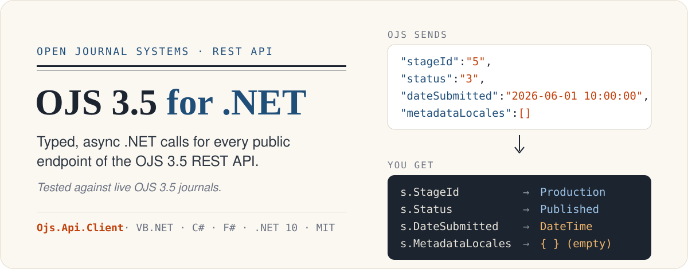
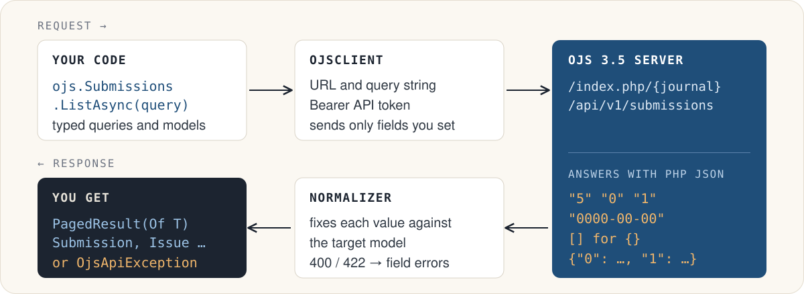

[](https://www.nuget.org/packages/Ojs.Api.Client) [](https://github.com/aldirafa/OJS3_5/actions/workflows/ci.yml) [](https://pkp.sfu.ca/software/ojs/) [](https://dotnet.microsoft.com/) [](https://github.com/aldirafa/OJS3_5/blob/HEAD/LICENSE.txt)

Manage an [Open Journal Systems](https://pkp.sfu.ca/software/ojs/) journal from .NET. The library covers:

* submissions, reviews, issues and users;
* DOIs, statistics and the rest of the OJS 3.5 REST API.

You get typed models and async calls, without wrestling with PHP's JSON. It is written in VB.NET and works the same
from C#, F# and PowerShell.

## Install

```
dotnet add package Ojs.Api.Client --prerelease
```

You need an API token from **User Profile > API Key** in OJS. The server must have `api_key_secret` set in the
`[security]` section of its `config.inc.php`.

## Quick start

**VB.NET**

```vb
Imports OJS3_5.Library

Using ojs As New OjsClient(New OjsClientOptions With {
    .BaseUrl = "https://journals.example.com",
    .JournalPath = "jpk",
    .ApiToken = Environment.GetEnvironmentVariable("OJS_TOKEN")})

    Dim current = Await ojs.Issues.GetCurrentAsync()
    Console.WriteLine(current.Identification)
    For Each article In current.Articles
        Console.WriteLine("  " & article.CurrentPublication?.Title.GetValue("en"))
    Next
End Using
```

**C#**

```csharp
using OJS3_5.Library;

using var ojs = new OjsClient(new OjsClientOptions
{
    BaseUrl = "https://journals.example.com",
    JournalPath = "jpk",
    ApiToken = Environment.GetEnvironmentVariable("OJS_TOKEN")
});

var current = await ojs.Issues.GetCurrentAsync();
Console.WriteLine(current.Identification);
foreach (var article in current.Articles)
    Console.WriteLine("  " + article.CurrentPublication?.Title.GetValue("en"));
```

**F#**

```fsharp
open OJS3_5.Library

task {
    use ojs =
        new OjsClient(OjsClientOptions(
            BaseUrl = "https://journals.example.com",
            JournalPath = "jpk",
            ApiToken = Environment.GetEnvironmentVariable "OJS_TOKEN"))
    let! current = ojs.Issues.GetCurrentAsync()
    printfn "%s" current.Identification
}
```

Two settings depend on the installation:

* **`index.php` in URLs.** If the journal's URLs contain it (`https://example.com/index.php/jpk`), set `UseIndexPhp = True`.
* **Types.** All types live in the `OJS3_5.Library` namespace and its sub-namespaces, such as `Models` and `Queries`.

## How it works



The OJS backend is PHP, and its JSON shows it:

* numbers and booleans arrive as strings, dates as `"Y-m-d H:i:s"`;
* `[]` stands in for an empty object;
* several responses differ from the OpenAPI document.

The library reads every value against the model it is bound to, so you work with `Integer?`, `DateTime?`,
`WorkflowStage` and `LocalizedString` instead. Each deviation we found on live journals is handled and listed on
[OJS 3.5 Quirks](https://github.com/aldirafa/OJS3_5/wiki/OJS-3.5-Quirks).

## Examples

### Paging through results

```vb
' One page
Dim page = Await ojs.Submissions.ListAsync(
    New SubmissionQuery With {.Status = {SubmissionStatus.Published}, .Count = 50})
Console.WriteLine($"{page.Items.Count} of {page.ItemsMax}")

' Every page
Dim all = Await ojs.Submissions.ListAllAsync(New SubmissionQuery With {.StageIds = {WorkflowStage.ExternalReview}})
```

```csharp
// Stream page by page; later pages are fetched only when needed
await foreach (var issue in ojs.Issues.Enumerate(new IssueQuery { IsPublished = true }))
    Console.WriteLine(issue.Identification);
```

### Multilingual metadata and partial updates

```vb
Dim pub = Await ojs.Publications.GetAsync(12, 15)
Console.WriteLine(pub.Title.GetValue("id", fallbackLocale:="en"))
Console.WriteLine(String.Join(", ", pub.Keywords.GetNames("en")))

' Only the properties you set are sent; everything else stays as it is.
Await ojs.Publications.UpdateAsync(12, 15, New PublicationEdit With {
    .Title = New LocalizedString From {{"en", "A better title"}, {"id", "Judul yang lebih baik"}},
    .Keywords = LocalizedVocab.Create("en", "open access", "scholarly publishing")})
```

### Uploads

```vb
' Images and other settings files: upload, then reference
Dim tmp = Await ojs.TemporaryFiles.UploadAsync("cover.jpg")
Await ojs.Publications.UpdateAsync(12, 15, New PublicationEdit With {
    .CoverImage = New Dictionary(Of String, CoverImage) From {{"en", New CoverImage With {.TemporaryFileId = tmp.Id}}}})

' Submission files
Using pdf = File.OpenRead("manuscript.pdf")
    Await ojs.SubmissionFiles.UploadAsync(12, pdf, "manuscript.pdf",
        New SubmissionFileEdit With {.FileStage = SubmissionFileStage.Submission, .GenreId = 1})
End Using
```

### Errors

```csharp
try
{
    await ojs.Submissions.SubmitAsync(12, confirmCopyright: true);
}
catch (OjsValidationException ex)
{
    foreach (var (field, messages) in ex.Errors)
        Console.WriteLine($"{field}: {string.Join(" ", messages)}");
}
catch (OjsApiException ex) when (ex.StatusCode == System.Net.HttpStatusCode.NotFound)
{
    Console.WriteLine("No such submission.");
}
```

### DOIs and statistics

```vb
Await ojs.Dois.Submissions.AssignAsync({12, 13})
Using xml = Await ojs.Dois.Submissions.ExportAndDownloadAsync({12, 13})
    Await xml.SaveAsAsync(xml.FileName)
End Using

Dim top = Await ojs.Stats.Publications.ListAsync(
    New PublicationStatsQuery With {.DateStart = New DateOnly(2026, 1, 1), .Count = 10})
Dim csv = Await ojs.Stats.Publications.ListCountriesCsvAsync()
```

### Several journals

```vb
For Each journal In Await ojs.Contexts.ListAllAsync()
    Dim client = ojs.ForJournal(journal.UrlPath)   ' shares the connection
    Console.WriteLine($"{journal.Name.GetValue("en")}: {(Await client.Submissions.ListAsync()).ItemsMax} submissions")
Next
```

## What's covered

| `OjsClient` property | Endpoints |
|---|---|
| `Submissions`, `Publications`, `Contributors`, `SubmissionFiles`, `Decisions`, `ReviewerSuggestions` | the editorial workflow |
| `Issues`, `Sections` | journal structure |
| `Users`, `Invitations` | accounts, roles and reviewers |
| `Contexts`, `Site` | journals, site settings and themes |
| `Announcements`, `Institutions` | news, and institutions for statistics |
| `EmailTemplates`, `Mailables`, `Emails` | emails |
| `Dois`, `Reviews`, `Orcid` | DOIs, review exports and ORCID |
| `Stats` | editorial, user and usage statistics, as JSON or CSV |
| `Vocabs`, `Rors` | keyword suggestions and the Research Organization Registry |
| `TemporaryFiles` | uploads referenced by other requests |
| `SendAsync` | raw access to any endpoint, including plugin APIs |

## Documentation

* **[Wiki](https://github.com/aldirafa/OJS3_5/wiki/Home):** one page per area, with examples in VB.NET, C# and F#.
* **IntelliSense:** every public member has a summary and an example.
* **[Sample app](https://github.com/aldirafa/OJS3_5/blob/HEAD/Samples/Library.Sample/Program.vb):** a small command-line tool with `issues`, `submission <id>`, `stats`, `export-dois` and more.

## Building and testing

```
dotnet build OJS3_5.slnx
dotnet test OJS3_5.slnx
```

* **Unit tests** need no server.
* **Live tests** run against a real journal when you set the `OJS_*` environment variables.
* **Tests that change data** also need `OJS_ALLOW_WRITES=1`. Run those against a test journal only. See
  [Testing and Contributing](https://github.com/aldirafa/OJS3_5/wiki/Testing-and-Contributing).
* **Documentation examples:** `pwsh tools/doc-check/check.ps1` compiles every one of them, in VB.NET, C# and F#.

## Compatibility

* **OJS** 3.5.x, tested against OJS 3.5.0.
* **.NET** 10 or later.

## License

[MIT](https://github.com/aldirafa/OJS3_5/blob/HEAD/LICENSE.txt)
